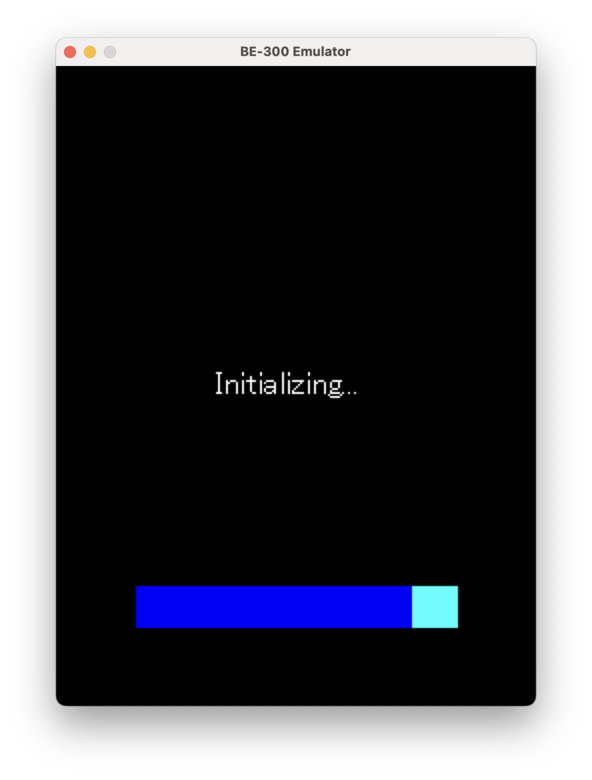
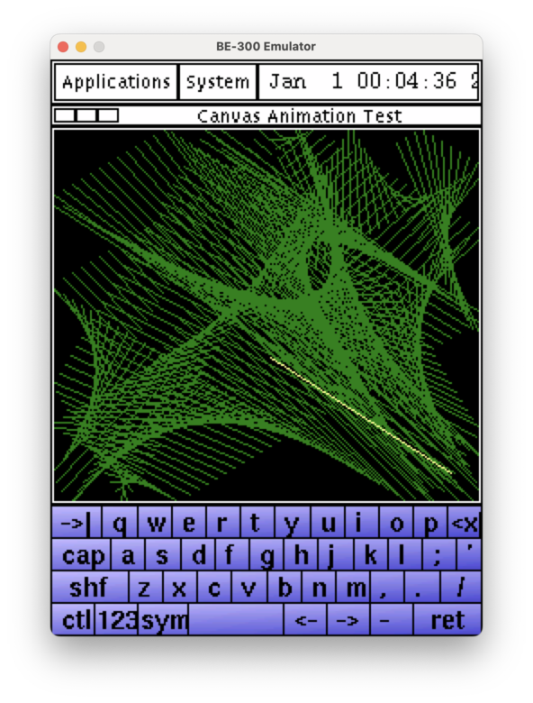

# Emulator Overview

The BE-300 emulator is a modified [GXemul 0.7.0](https://gavare.se/gxemul/) system emulator purpose-built for the Casio BE-300 handheld. It provides cycle-accurate emulation of the NEC VR4131 MIPS CPU and surrounding hardware, enabling both Linux and Windows CE operating systems to boot and run.

## Capabilities

- **Linux kernel boot** — Boots Linux 2.4, 2.6, and 4.2.9 kernels to userspace with framebuffer and serial console output
- **WinCE cold boot** — Cold-boots Windows CE 3.0 and 4.0 from the real 16KB boot ROM through the Secondary Program Loader (SPL) to NK.exe, exactly as real hardware does after battery removal
- **Hardware-accurate emulation** — VR4131 MIPS CPU with full TLB/MMU, CP0 coprocessor, MIPS16 instruction support, and peripheral emulation (ICU, RTC, NAND, GPIO, UART, framebuffer)
- **Cross-platform** — Runs natively on macOS and Linux; also available as a web application via Emscripten/WebAssembly

## Current Status

The emulator is under active development. Linux kernels boot fully to userspace with PicoGUI desktop environments. WinCE cold boot reaches kernel initialization and the scheduler, progressing through the ROM boot sequence, SPL decompression, and NK.exe entry.

!!! info "Development Philosophy"
    The project prioritizes hardware-accurate emulation over workarounds. The ROM and NK.exe binaries are captured from real hardware and run unmodified. When guest OS behavior fails, the root cause is always a missing or incorrect hardware behavior in the emulator.

## Screenshots

**WinCE 3.0 NAND Boot**

**Linux PicoGUI Desktop**

## Key Features

| Feature | Details |
|---------|---------|
| CPU | NEC VR4131 (MIPS32 little-endian) via GXemul engine |
| RAM | 16 MiB SDRAM |
| Display | 240x320 16-bit framebuffer via SDL2 |
| Boot ROM | Real 16KB masked ROM from hardware (PA 0x1FC00000) |
| MIPS16 | Full interpreter for boot ROM's compact code sections |
| NAND | Controller emulation with OOB synthesis and ECC |
| Peripherals | ICU, RTC, BCU, CMU, PMU, GPIO, SIU (UART), PPSH |
| dyntrans | GXemul dynamic binary translation for performance |
