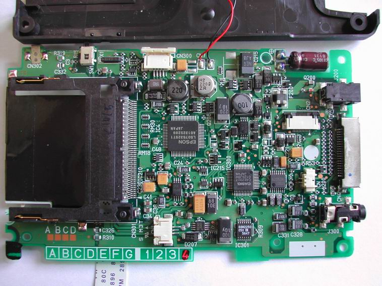
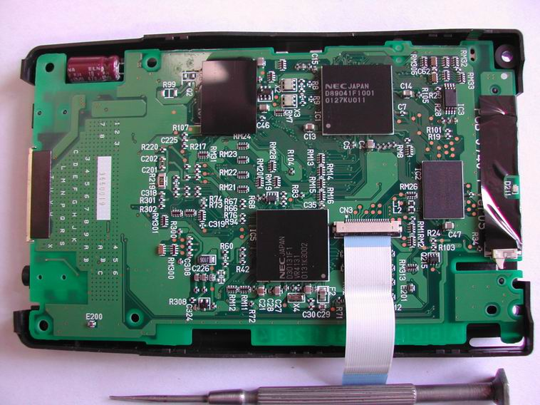
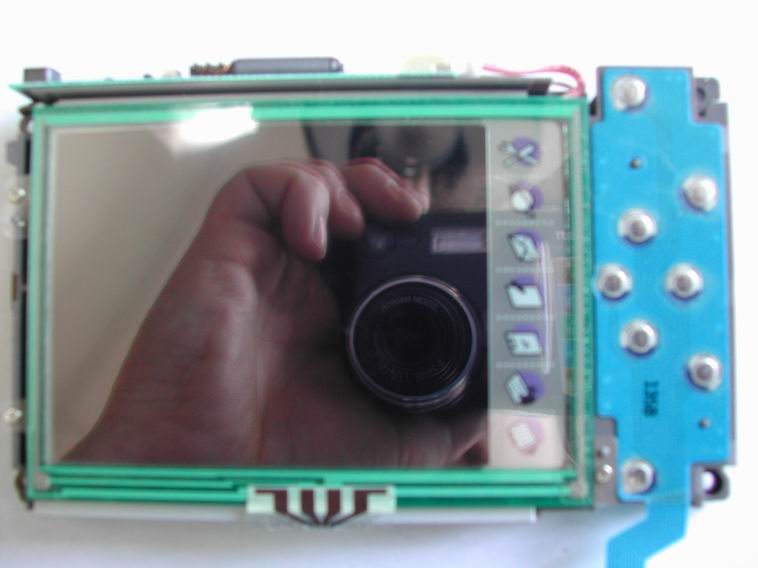
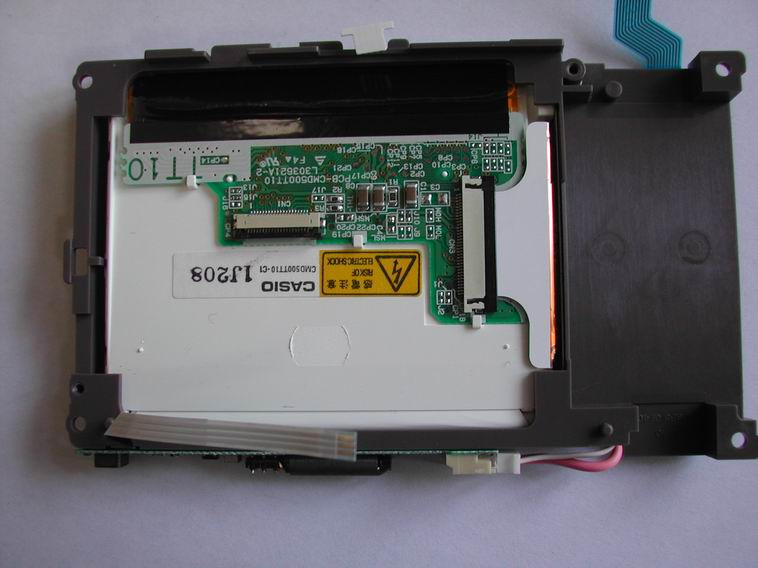
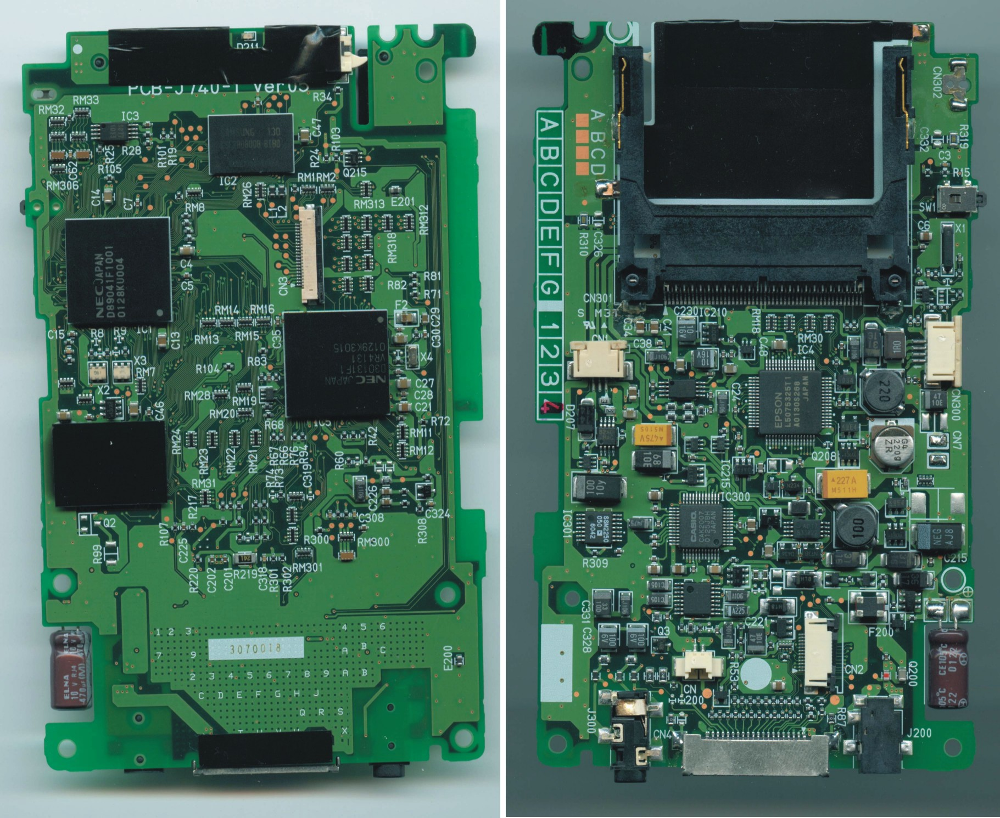
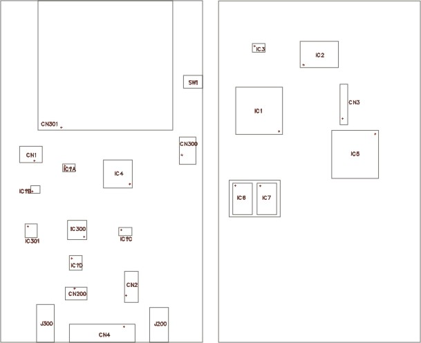
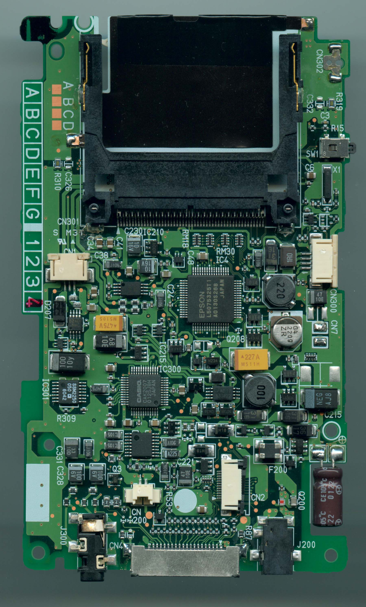
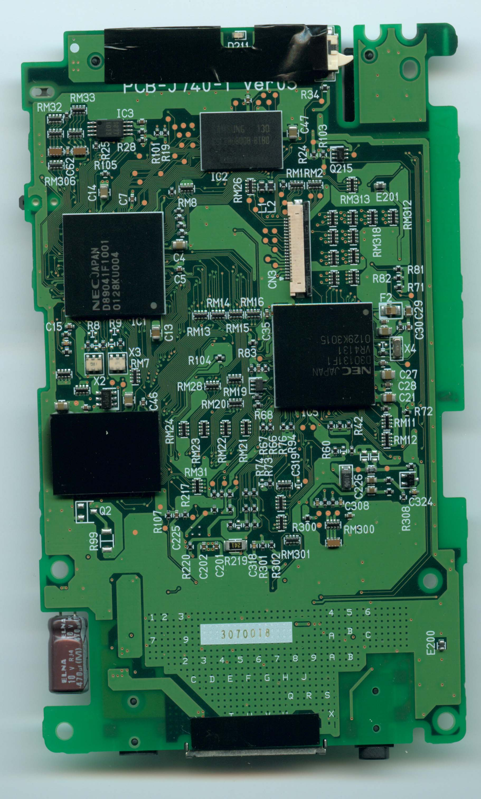
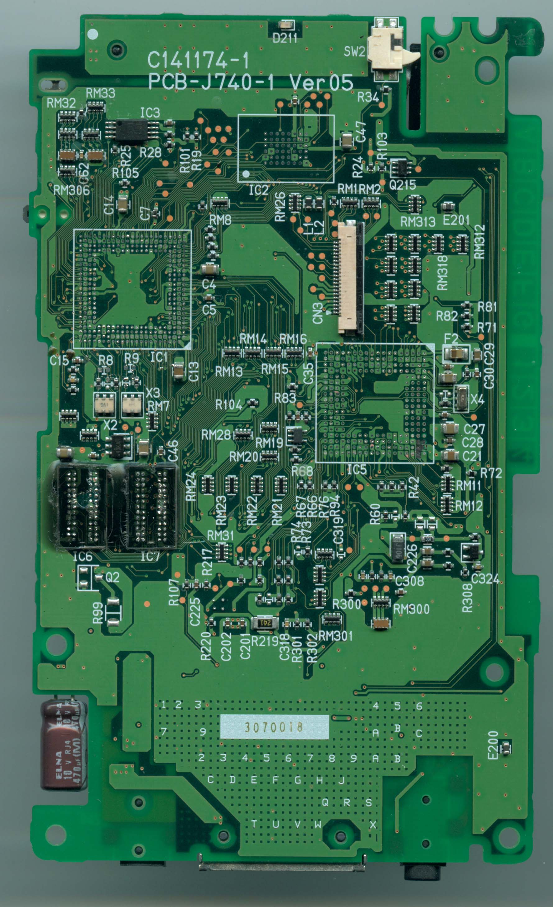

# Board Photos

Photographs of the BE-300 mainboard and LCD assembly, showing component placement and chip identification.

## Main Board -- Top

The top side of the mainboard shows the NEC VR4131 SoC, VRC4173 companion chip, Samsung SDRAM, and NAND flash.

## Main Board -- Bottom

The bottom side of the mainboard with the Casio CAK2007 custom chip and supporting components.

## LCD Assembly -- Top

The LCD module top side, showing the flex cable connection to the mainboard.

## LCD Assembly -- Bottom

The LCD module bottom side with the EPSON L50753 LCD controller.

## High-Resolution Board Views

High-resolution composite showing both sides of the mainboard.

Overview of both board sides at standard resolution.

## Additional Views (jal0)

Detailed photographs from jal0 showing component-level detail:

## Board with Chips Removed

Bottom side of the board with major ICs desoldered, showing the PCB traces and pad layout underneath.
