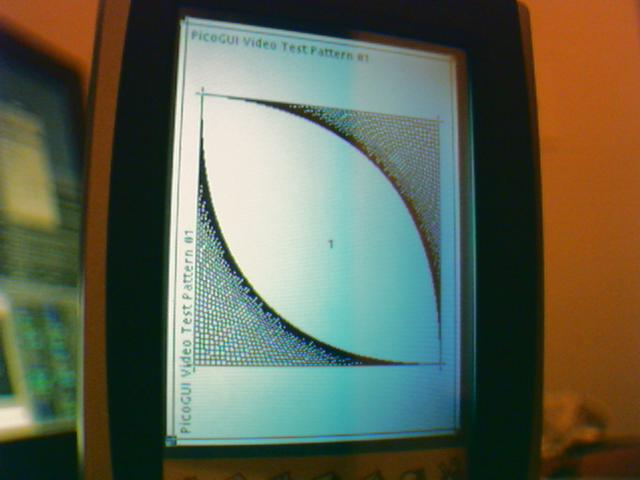
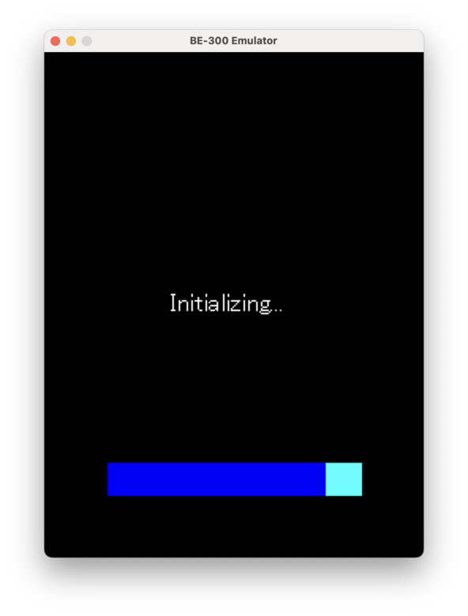

# Casio Cassiopeia BE-300 Wiki

The **Casio Cassiopeia BE-300** is a Windows CE-based pocket PC released in 2002. Built around the NEC VR4131 MIPS processor at 166 MHz with 16 MB of SDRAM and 16 MB of NAND flash, it features a 240x320 color STN display and runs Windows CE 3.0 out of the box.

This wiki documents the hardware architecture, Windows CE firmware internals, the historical Linux4.BE porting effort (2002--2004), and a modern emulator that boots the device from its ROM reset vector through the full cold-boot sequence.

-   **Hardware Reference**

    ---

    NEC VR4131 SoC, VRC4173 companion chip, memory map, NAND flash, framebuffer, GPIO, and board photos.

    [:octicons-arrow-right-24: Hardware](hardware/index.md)

-   **Windows CE Internals**

    ---

    Boot ROM, SPL bootloader, NK.exe cold boot, NAND layout, restore images, PPSH debug shell, and hibernate/resume.

    [:octicons-arrow-right-24: Windows CE](wince/index.md)

-   **Linux4.BE Archive**

    ---

    Historical documentation of the Linux port: bootloader, kernels, ramdisks, toolchain, and PicoGUI.

    [:octicons-arrow-right-24: Linux4.BE](linux4be/index.md)

-   **Emulator Documentation**

    ---

    Architecture, building, running, GXemul integration, web/Android frontends, PC Connect, and analysis tools.

    [:octicons-arrow-right-24: Emulator](emulator/index.md)

## The Device

{ width="320" }

The BE-300 was one of the few MIPS-based Windows CE handhelds to receive a community Linux port. The Linux4.BE project (2002--2004) produced working 2.4 and 2.6 kernels with serial console, framebuffer, and PicoGUI support, though hardware driver coverage remained limited.

## The Emulator

{ width="320" }

The emulator performs a true cold boot from the 16 KB masked ROM at `0xBFC00000`, loading the SPL from NAND, decompressing NK.exe into RAM, and reaching the Windows CE first-boot UI from unmodified guest binaries. It uses GXemul 0.7.0 as its MIPS CPU engine with native CP0, TLB, MIPS16, and dyntrans support.

## Key Specifications

| Parameter | Value |
|---|---|
| CPU | NEC VR4131, MIPS32 LE, 166 MHz |
| RAM | 16 MB SDRAM (2x Samsung K4S641633D) |
| Storage | 16 MB NAND (Samsung K9F2808U0B) |
| Display | 240x320, 16-bit color STN |
| ROM | 16 KB masked ROM at PA 0x1FC00000 |
| OS | Windows CE 3.0 (upgradeable to .NET 4.x) |
| Companion | NEC VRC4173 |
| Connectivity | RS-232C serial, headphone jack, CompactFlash slot |
