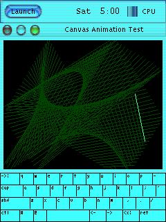
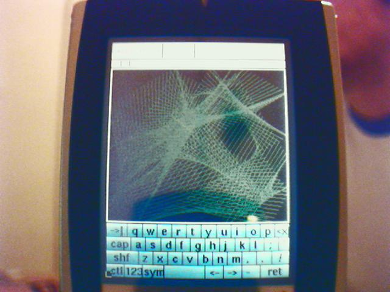
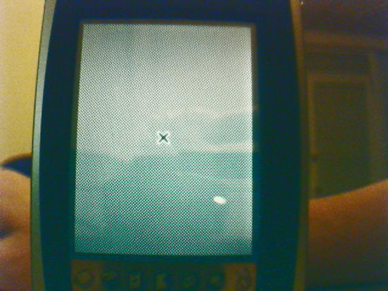

# GUI Frameworks

## Overview

Several graphical user interface frameworks were tested on the BE-300's small 16-bit color display. The primary challenge was fitting a usable GUI into the limited RAM (16 MB shared with the kernel and ramdisk) while providing text input through the device's minimal hardware buttons.

## PicoGUI

PicoGUI was the primary GUI framework used by the Linux4.BE project. It is a lightweight client-server windowing system designed for embedded devices with small displays and limited input.

The `vmlinux-pgui-demo` kernel is the reference build, confirmed to boot to a working PicoGUI desktop on real hardware. The ramdisk `ramdisk-pgui-full.gz` contains the full PicoGUI environment.

Features demonstrated on the BE-300:

- Desktop with window management
- Virtual keyboard for text input
- Terminal emulator
- Demo applications

Text input used the Rocket button combined with the directional pad to cycle through and select characters. See the [Getting Started](getting-started.md) page for the complete button mapping.

## MicroWindows / Nano-X

MicroWindows (also known as Nano-X) is another lightweight embedded GUI framework. The `vmlinux-mw` kernel build includes MicroWindows support. It provides a basic windowing system with drawing primitives, font rendering, and input handling.

## X Window System

The X Window System was successfully tested on the BE-300, demonstrating that even a full X server could run on the device's limited hardware.

While functional, X was heavier than PicoGUI or MicroWindows and left less free RAM for applications.

## Qt/Embedded

A Qt/Embedded build was available (`vmlinux-qte`). Qt/Embedded (later renamed Qt for Embedded Linux) runs without an X server, drawing directly to the Linux framebuffer. It provides a richer widget set than PicoGUI or MicroWindows at the cost of higher memory usage.

## OPIE

OPIE (Open Palmtop Integrated Environment), a fork of the Qtopia/QPE environment originally developed for the Sharp Zaurus, was considered as a future direction for the project. OPIE would have provided a complete PDA-style interface including a calendar, contacts, and file manager. This was not completed before the project wound down.

## Input Handling

All GUI frameworks relied on the BE-300's hardware buttons for input. The button keyboard driver (contributed by jal0) mapped the physical buttons to key events. The Rocket button acted as a modifier key, enabling character-by-character text entry through a cycling selection mechanism.
