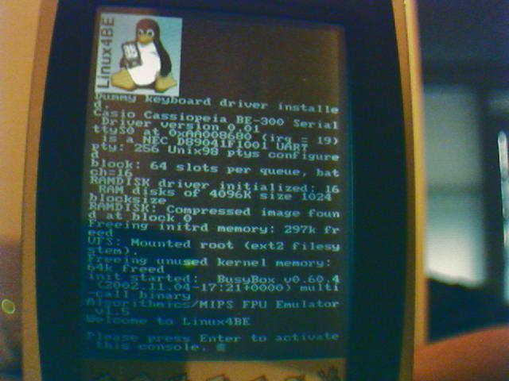
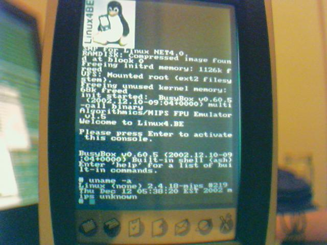
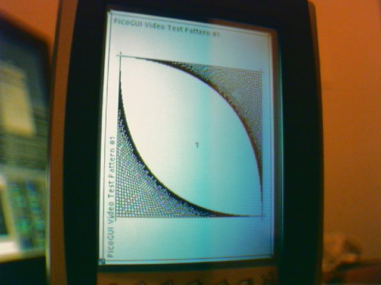

# Linux4.BE Project History

Linux4.BE was a community project (2002--2004) that ported the Linux kernel to the Casio Cassiopeia BE-300 handheld. Founded and coordinated by Filip from Belgium, the project operated from the website linux4.be and brought together a small international team of developers who reverse-engineered the hardware and built a working Linux distribution for the device.

## Goals

The project aimed to run a standard Linux kernel on the BE-300, a device originally shipped with Windows CE 3.0. Because Casio provided no public hardware documentation beyond the NEC VR4131 CPU datasheet, nearly every peripheral had to be reverse-engineered from scratch. The boot method was deliberately non-destructive --- Linux ran from a CompactFlash card using the CyaCE loader, and a simple reset returned the device to Windows CE.

## Key Contributors

| Contributor | Role |
|-------------|------|
| **Filip** | Project lead, website admin, kernel builds, memory configuration research |
| **jroark (Antagonizt)** | Serial driver, kernel builds, ramdisk creation, PicoGUI integration |
| **Andrey Shuvikov** | Hardware reverse engineering (interrupts, video, touchscreen, serial, CompactFlash) |
| **jal0** | Windows cross-toolchain, hardware board mapping, schematics, monitor program |
| **Mouse** | Linux 2.6 kernel port |
| **themaw (Marc)** | Kernel collaboration |
| **Brian** | Contributor |

## Timeline

### 2002

- **February:** Project starts. Filip creates the linux4.be website and publishes InspectorTux, a WinCE tool for probing device hardware. Initial screen resolution discovery and system information gathering.
- **March:** Custom flash ROM reading and modification capability achieved. Serial traces captured during factory restore process.
- **May:** NEC VR4131 preliminary user manual documentation added to the project.
- **June:** Memory configuration documented --- RAM, ROM, and Flash FAQ published.
- **July:** Serial driver progress. Kernel patches posted online. Website restructured into sections for different experience levels (dummies, developers, hackers).
- **December:** jal0 contributes hardware board mapping and button keyboard driver. Schematics and monitor program development.

### 2003

- **January:** The "Dummies" howto is published, providing easy-to-follow instructions for non-technical users to boot Linux on the BE-300. This was a milestone for project accessibility. First pre-built Linux packages released.
- **2003 (ongoing):** PicoGUI integration, MicroWindows/Nano-X builds, ramdisk improvements. Multiple kernel configurations tested and published.

### 2004

- **Mouse contributes a Linux 2.6.8.1 port**, bringing the BE-300 forward to a modern kernel version. The 2.6 port required significant rework of the platform initialization code.

## Boot Method

The project used a non-destructive boot method based on the CyaCE loader. Users copied the Linux4BE directory to a CompactFlash card, inserted it into the BE-300, and ran AutoRun.exe. The CyaCE loader loaded the Linux kernel and ramdisk into memory and transferred control. No ROM flashing or permanent modification was required --- pressing the reset button returned the device to Windows CE.

## GUI Environments

Several graphical environments were tested on the 320x240 display:

- **PicoGUI** --- the primary GUI framework, with a working desktop and virtual keyboard
- **MicroWindows/Nano-X** --- alternative lightweight GUI
- **X Window System** --- tested and functional
- **Qt/Embedded** --- build available

## Notable Events

Casio Japan visited the linux4.be website multiple times, as confirmed by server access logs. The project was noticed by its target hardware manufacturer, though no official collaboration resulted.

## Legacy

The linux4.be website has been preserved from archive.org and is browsable in the [archive section](/static/archive/linux4be/) of this wiki. The kernel source, tools, and documentation remain valuable as the most thorough public reverse-engineering effort of the BE-300 hardware.
